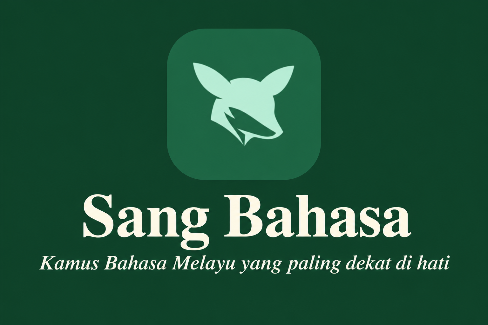

# Hi, it's Nuz Zealous!
> 🌟 I'm a pre-U student aspiring to be a full-stack developer - one who turns a single-line pitch into a standout product.

## About Me
I specialise in transforming ideas into **polished software**. My **ability and passion** for building scalable programs from scratch drove me into **full-stack development**. Beyond the code, you can find me *writing*, enjoying *yoga*, or *travelling with my family*. I believe great technology is built through **empathy** and **perseverance**.

### My Digital Passions
- **Software**: Innovating software from scratch and improving it constantly
- **FOSS**: Contributing to FOSS projects (and starting my own!)
- **Hackathons**: Joining hackathons to push my limits and to be inspired by brilliant builds!

## Featured Work

### A. Sang Bahasa

**Visi**: Memelihara dan memartabatkan keindahan warisan bahasa Melayu agar kekal segar, relevan, dan dekat di hati generasi masa kini. 

**Misi**: Membina kamus digital khas peribahasa dan bahasa klasik Melayu yang moden dengan carian pantas, paparan kemas, serta lengkap dengan contoh ayat dan padanan bahasa standard.

- **Teknologi**: Astro, TypeScript, Supabase, Vercel
- **GitHub Repo**: https://github.com/Nut2026/sang-bahasa
- **Laman Web**: [Kunjungi Sekarang](https://sang-bahasa.vercel.app)



### B. SnackGlobe

**Vision**: A world where cultural heritage is preserved and shared through the universal language of food. 

**Mission**: To build cultural infrastructure for the connected future by using AI to tell the stories behind traditional snacks and making them accessible to everyone via customisable recipes.

- **Teknologi**: React, TypeScript, Vite, Supabase, Groq
- **GitHub Repo**: https://github.com/Nut2026/snackglobe
- **Demo Video**: 

[](https://youtu.be/bFxdJRkgjqw)

## Tech Stack
- **Languages**
[](https://python.org/) [](https://www.typescriptlang.org/)
- **Web Development**
[](https://fastapi.tiangolo.com/) [](https://reactjs.org/) [](https://vitejs.dev/) [](https://astro.build/) [](https://tailwindcss.com/)
- **Plugins & Scripts**
[](https://addons.ankiweb.net/) [](https://code.visualstudio.com/api) [](https://inkscape.org/) [](https://sheets.google.com/)
- **AI & Automation**
[](https://groq.com) [](https://docs.telethon.dev/) [](https://python-telegram-bot.org/)
- **Databases**
[](https://www.postgresql.org/) [](https://www.sqlite.org/) [](https://supabase.com/)
- **Deployment**
[](https://vercel.com/) [](https://railway.app/) [](https://www.cloudflare.com/)
- **Design**
[](https://inkscape.org/) [](https://ibispaint.com/) [](https://clipchamp.com/)

## My Dev Stats
<!--START_SECTION:waka-->


**I'm an Early 🐤** 

```text
🌞 Morning                94 commits          ████████░░░░░░░░░░░░░░░░░   32.75 % 
🌆 Daytime                89 commits          ████████░░░░░░░░░░░░░░░░░   31.01 % 
🌃 Evening                98 commits          █████████░░░░░░░░░░░░░░░░   34.15 % 
🌙 Night                  6 commits           █░░░░░░░░░░░░░░░░░░░░░░░░   02.09 % 
```
📅 **I'm Most Productive on Saturday** 

```text
Monday                   19 commits          ██░░░░░░░░░░░░░░░░░░░░░░░   06.62 % 
Tuesday                  13 commits          █░░░░░░░░░░░░░░░░░░░░░░░░   04.53 % 
Wednesday                40 commits          ███░░░░░░░░░░░░░░░░░░░░░░   13.94 % 
Thursday                 49 commits          ████░░░░░░░░░░░░░░░░░░░░░   17.07 % 
Friday                   45 commits          ████░░░░░░░░░░░░░░░░░░░░░   15.68 % 
Saturday                 103 commits         █████████░░░░░░░░░░░░░░░░   35.89 % 
Sunday                   18 commits          ██░░░░░░░░░░░░░░░░░░░░░░░   06.27 % 
```


📊 **This Week I Spent My Time On** 

```text
💬 Programming Languages: 
TypeScript               2 hrs 30 mins       ████████░░░░░░░░░░░░░░░░░   33.90 % 
Astro                    1 hr 10 mins        ████░░░░░░░░░░░░░░░░░░░░░   15.95 % 
Other                    59 mins             ███░░░░░░░░░░░░░░░░░░░░░░   13.45 % 
HTML                     59 mins             ███░░░░░░░░░░░░░░░░░░░░░░   13.39 % 
Python                   42 mins             ██░░░░░░░░░░░░░░░░░░░░░░░   09.55 % 

🔥 Editors: 
VS Code                  6 hrs 50 mins       ███████████████████████░░   92.43 % 
Copilot CLI              33 mins             ██░░░░░░░░░░░░░░░░░░░░░░░   07.57 % 
```

🤖 **AI Coding This Week** 

```text
⏱ AI Coding Time: 1 hr 27 mins (19.74%)

✍️ 0 lines written by AI, 98 lines written by hand (0.0% AI-written)

🔤 264,980 Input Tokens, 16,625 Output Tokens

💵 $0.08 Estimated AI Cost This Week

🧠 3 AI Sessions, 6 AI Prompts

GPT                      0 lines             ░░░░░░░░░░░░░░░░░░░░░░░░░   00.00 % 

🔎 AI Coding Insights:
🧑‍💻 Mostly Hands-On — 0.0% of written lines came from AI
📝 Concise Prompter — average 371 characters per prompt
🔁 Iterative Prompter — average 2 prompts per session
🔍 Hands-On Reviewer — 100.0% of changed lines were hand-edited
```


<!--END_SECTION:waka-->

## Let's Build Amazingz Together

> 🟢 Currently available for freelance / part-time roles / open-source collaboration.

[](mailto:nuzealouss@gmail.com)
[](https://t.me/nutnotnuts)
[](https://discord.com/users/1317008280911876109)

[](https://devpost.com/nuzealous)
[](https://github.com/Nut2026)

*(You are here!)*
